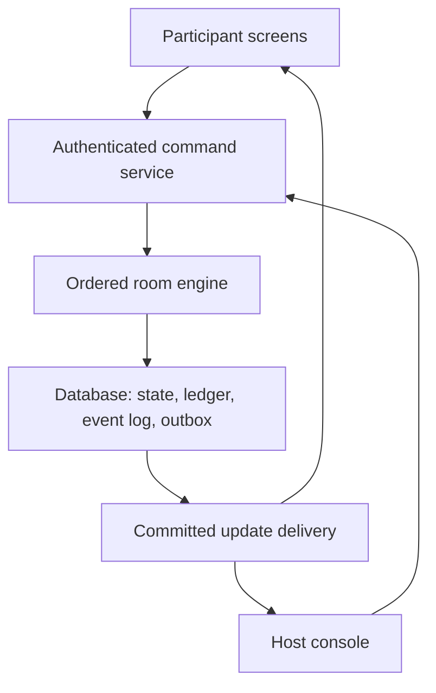

# Stocks-only trading competition: proposed MVP blueprint

9 November 2026

**Recommendation:** build a browser-based competition in which teams trade a common catalogue of stocks against a simulated market maker. Hosts control the event, news and scenario; a deterministic server calculates prices, execution costs, collateral and rankings.

This is a proposed design, not an implementation or a claim to have recovered The Trade House's private code. All numeric defaults below are recommendations to calibrate in a pilot. They are not choices already confirmed by you.

## 1. What the available evidence establishes

I reviewed the supplied 87-second admin-panel recording and The Trade House's public pages.

| Evidence | What it establishes | What it does not establish |
|---|---|---|
| Recording, approximately 0–15 seconds | Category switches, a market sensitivity setting, event overview, round creation, duration and minimum-trade configuration | How prices or fills are actually computed |
| Recording, approximately 15–25 seconds | A news broadcast area and team creation/import, including starting cash | Precise news-to-price execution timing |
| Recording, approximately 25–32 seconds | Stock creation with initial price, shares float, trading suspension and circuit settings | Whether float is strictly conserved in every transaction |
| Recording, approximately 50–65 seconds | Portfolio inspection and additional event settings | Short-selling accounting or a functioning participant trade |
| Public home page [1] | Trade impact depends on order size relative to float and a sensitivity dial; hosts assign news shocks | Exact fill prices, arithmetic, rounding, concurrency or proprietary implementation |
| Public organizer and participant pages [2][3] | Event controls, team access, portfolio tracking, ranking and news workflows | The backend stack, hidden validation or short-sale support |

The recording shows an unpopulated market. It contains no controlled before/after trade from which an exact pricing equation could be estimated. The public material reviewed also does not establish that shorting is available. Treat shorting as a requirement of your new product.

### A plausible reconstruction of their advertised price rule

A simple rule consistent with the public illustration would be:

\[
P_{next}=P\left(1+s\,v\frac{q}{F_{float}}\right)
\]

Here `s` is +1 for participant buying and −1 for participant selling, `q` is share quantity, `F_float` is float and `v` is the sensitivity dial. At `v = 1`, buying 1,000 shares against 100,000 float implies a 1% upward move.

**This is an inference, not verified source code.** The public illustration cannot identify whether the engine uses this equation, a nonlinear variation, or special handling at boundaries. News can be represented by a host-assigned multiplier `1 + h`.

The useful lesson is that a live simulation can react to orders and news. Continuous random movement is optional.

## 2. Scope and assumptions

Interpret “n stocks” as a common list of n stocks that every team may trade. Start everyone with equal cash. If you instead want teams to begin with shares, give them an identical starting basket and equal starting net worth.

Proposed pilot:

| Setting | Starting proposal |
|---|---|
| Participants | 50 teams, one portfolio per team |
| Stock catalogue | 10 fictional companies across 4–5 sectors |
| Starting cash | ₹10,00,000 per team |
| Event | A separate practice round, followed by 3 × 20-minute scored rounds |
| Carry-forward | Positions and cash continue between scored rounds |
| Orders | Immediate buy, sell, short and cover; all-or-none quantity |
| Counterparty | A simulated dealer, rather than another participant |
| Prices | News anchor plus temporary participant demand pressure |
| Ambient noise | Off for the first validation run; optional small noise after calibration |
| Ranking | Highest final portfolio liquidation value after closing costs |
| Leaderboard | Hosts control audience visibility; each team always sees its own score |

Fictional companies let hosts write a coherent story and distribute comparable starting research to everyone. Real company names can be used if their prices are clearly labelled as simulated.

Initial scope excludes IPOs, bonds, ETFs, real brokerage connections, options, a participant order book and resting limit orders. A market-order ticket can still include a maximum buy price or minimum sell price as an immediate execution protection.

## 3. Approaches considered

| Approach | How it works | Strength | Main limitation |
|---|---|---|---|
| Host-driven prices | Prices follow host events and optional seeded randomness; participant trades do not move prices | Easiest to build, explain and audit | Less interaction between teams |
| Participant order book | Participants submit bids and offers; a matching engine pairs compatible orders | Actual participant price discovery | Small events can have poor liquidity; partial fills, queues and inventory add complexity |
| Hybrid simulated dealer — recommended | A dealer fills valid orders along a price curve; news shifts the underlying anchor | Immediate trading with meaningful market impact and host control | Requires careful execution and scoring rules |

The hybrid is the working recommendation because the requested event needs dependable buying, selling and shorting even when few teams trade one stock. This document is a proposal for review; no production app is being built at this stage.

## 4. The market model

### 4.1 Separate three causes of movement

For stock i, maintain:

- `A_i`: the scenario price anchor, initially equal to the opening price.
- `d_i`: temporary demand pressure in log-price units, initially zero.
- `z_i`: optional background log-price disturbance, initially zero.

The current mid-price is:

\[
M_i=A_i\exp(d_i+z_i)
\]

The mid-price is a reference quote. An order's average execution price differs because it consumes liquidity and pays a spread.

**News changes A. Participant trades change d. Optional background movement changes z.** Keeping these separate makes both tuning and event replay understandable.

### 4.2 Order impact

Let `x` be signed shares: positive when a participant buys or covers a short, negative when a participant sells or opens a short. Let `L_i` be liquidity depth in shares and `lambda_i` be impact sensitivity.

\[
d_i^{after}=d_i^{before}+\lambda_i\frac{x}{L_i}
\]

Therefore, while the anchor and disturbance stay fixed during the order:

\[
M_i^{after}=M_i^{before}\exp\left(\lambda_i\frac{x}{L_i}\right)
\]

Larger orders move prices more; deeper stocks move less. For small orders the percentage move is approximately `lambda × x / L`.

Every trade has two sides. Here, “buying pressure” means participant buying against the simulated dealer. Do not count both sides of the same matched transaction as separate demand.

Use **liquidity depth** as the admin label. A company's real-world float and the amount of liquidity near its current quote are different concepts. This MVP does not impose a finite outstanding-share model. Its synthetic dealer supplies liquidity, while a separate borrow pool limits participant shorts. A finite-float model would require additional dealer-inventory and stock-lending accounting.

### 4.3 Execution along the curve

A common implementation mistake is to give a large buy its entire quantity at the old price, then mark the position at the higher price that the buy itself created.

Instead, let an order traverse the curve. With `a = lambda / L`, the signed cash amount paid to the dealer before fees is:

\[
K_i(x)=\int_0^x M_i e^{a u}\,du
=M_i\frac{e^{a x}-1}{a}
\]

The average fill is `K(x) / x`. K is negative on a sale, representing cash received. For zero sensitivity use the limit `K(x) = M × x`. In an implementation, use a numerically stable exponential-minus-one calculation near zero.

Let `s` be half-spread and `f` be the transaction fee, both expressed as fractions of notional:

\[
B_i(x)=K_i(x)+(s+f)|K_i(x)|
\]

Then update team cash with `cash_after = cash_before − B(x)` and shares with `q_after = q_before + x`. This charges more for a purchase and returns less for a sale.

This convention gives a useful consistency property: with no time passing, news or other orders, splitting one order into smaller pieces follows the same curve and has the same unrounded cost. Buying and immediately reversing cannot generate cash before costs, and loses cash after costs. Rounding and minimum fees must not undermine that property.

### 4.4 Worked example

This deliberately uses a thinner stock to make the effect visible: mid ₹100, depth 100,000 shares, sensitivity 1, and a 1,000-share buy. Half-spread is 0.10%; fee is 0.05%. Assume no pressure decay, noise or other orders between the purchase, news and exit, so the example isolates the news effect.

| Step | Result |
|---|---:|
| Opening mid-price | ₹100.00 |
| Average buy fill before costs | ₹100.501671 |
| Purchase notional | ₹1,00,501.67 |
| Cash paid including spread and fee | ₹1,00,652.42 |
| Mid-price after this purchase | ₹101.005017 |
| Host increases the anchor by 8% | New mid ₹109.085418 |
| Team exits all 1,000 shares along the reverse curve | Net cash received ₹1,08,378.99 |
| Realized profit after both transactions' costs | ₹7,726.57 |

If it bought and immediately exited before the news, it would lose approximately ₹301.51 in spread and fees. It would not receive a free profit from its own impact.

### 4.5 Temporary pressure and optional noise

Background dealer liquidity gradually absorbs temporary pressure. With half-life H measured in active trading minutes:

\[
d_i(t+\Delta t)=d_i(t)\,2^{-\Delta t/H_i}
\]

A positive demand premium thus tends to fade, while a news-driven anchor shift remains. This is an explicit game assumption about background liquidity, not a calibrated empirical law.

For the first run, set noise to zero. If later desired:

\[
z_i(t+\Delta t)=z_i(t)+\sigma_i\sqrt{\Delta t}\,\epsilon_i,
\quad \epsilon_i\sim N(0,1)
\]

Use active minutes as the time unit. For example, sigma = 0.001 means 0.10% log-price volatility per square-root minute. A one-second step uses `Delta t = 1/60`, not 1. Market-wide and sector-wide shared shocks can later provide correlated movement; avoid giving each stock a completely unrelated random story.

Draw randomness once per server tick for the whole event, from a recorded seed. Browsers never create their own market paths. No noise or pressure decay occurs during a pause.

## 5. Host-controlled news

Each news item has participant-facing content and a private numerical effect definition.

| Public fields | Private engine fields |
|---|---|
| Headline, explanation, publication time, optional source/scenario label | Affected stocks, signed anchor shocks, scheduled activation, optional volatility change |

For a stock assigned shock h:

\[
A_i^{new}=A_i^{old}(1+h_i),\quad h_i>-1
\]

For a fictional fuel-supply disruption, a host could choose OilCo +6%, AirCo −8%, LogisticsCo −4% and SoftwareCo 0%. These are authored scenario assumptions, not predictions about actual sectors. Compound successive impacts multiplicatively.

Support both mechanical news, which changes the anchor, and information-only news, which leaves the anchor unchanged and lets participants react through demand. Keep exact impact percentages, unreleased drafts and future event outcomes private.

### Fair publication

Do not broadcast “a positive announcement” while leaving everyone able to buy at a stale guaranteed price before a known automatic jump.

Recommended mechanical-news sequence:

1. Briefly suspend order acceptance for the affected stock or room.
2. Commit the headline, anchor change, updated quotes and a new market version together.
3. Broadcast the committed state and one server-controlled reopening time, for example three seconds later.
4. Resume trading at the updated curve. Recheck stale submissions against current prices and protection limits.

This reduces latency advantages. It cannot make network delivery literally simultaneous, so the game must not depend on a guaranteed profit available only to the first device receiving a flash.

### Where the strategy comes from

A fully priced instantaneous announcement rewards positions established before the announcement. It does not, by itself, create a reason to buy immediately afterward.

Give teams company profiles and conflicting clues; release a sequence of announcements, rumors and confirmations. Some items can affect only beliefs and order flow. If gradual information incorporation is added later, make its future outcome uncertain. A disclosed, guaranteed future +8% move mostly tests speed and borrowing limits.

Build a scenario calendar before the event, with 6–10 substantive developments over an hour, dependencies between announcements and a rationale for each stock's exposure. Hosts can still publish unscheduled events, but every intervention should be logged.

## 6. Buy, sell, short and cover

Store one signed position per team per stock:

| Position | Meaning |
|---|---|
| q > 0 | Team owns shares |
| q = 0 | No exposure |
| q < 0 | Team owes shares from a short |

Buying adds to q; selling subtracts from q. The interface should make the intent explicit: sell existing holdings, open a short, or cover an existing short. If an order would cross zero, either reject it and require a second action or split it into a closing and opening leg with separate opening-risk checks. For the first version, reject crossings and explain the required second action.

### Cash and equity

Let C be total ledger cash, including any cash restricted as short collateral. Then:

\[
E=C+\sum_i q_i M_i
\]

Negative q automatically subtracts the short liability. Fees already posted to cash must not be subtracted again.

Example, ignoring costs and impact: begin with ₹1,00,000, short 100 shares at ₹100, and receive ₹10,000. Cash becomes ₹1,10,000, the liability is ₹10,000 and equity stays ₹1,00,000. If the stock falls to ₹80, covering costs ₹8,000 and leaves ₹1,02,000. If it rises to ₹120, equity falls to ₹98,000 before closing costs.

### Restricted proceeds and risk limits

Let `S = sum(max(-q_i, 0) × M_i)` be total short notional. A simple initial collateral policy is:

\[
R=1.5S,\qquad available\ cash=C-R
\]

The restriction includes the short-sale proceeds plus additional collateral. It is part of C, not extra cash. Available cash is a spending limit, not portfolio value.

Proposed opening limits, evaluated after execution costs and the order's price impact:

- Nonnegative available cash.
- Gross exposure `G = sum(abs(q_i) × M_i)` no greater than 100% of equity.
- Each stock's absolute position no greater than 25% of equity.
- Total short notional no greater than 25% of equity.
- Enough shares left in that stock's synthetic borrow pool.

These are game rules, not representations of Indian brokerage regulations. Exposure limits stop teams from making the outcome primarily a leverage contest. Shorts remain useful for expressing a negative view and hedging.

Use a lower maintenance threshold to avoid constant forced exits after small moves. Proposed triggers are `C < 1.3S` or `E < 0.75G`. When a team fails opening limits but stays above maintenance, allow risk-reducing orders that improve the relevant violation. When maintenance fails, flag it for a deterministic liquidation procedure; a simple MVP procedure closes its whole portfolio through the current curves and records every fill. Emergency closure must bypass normal opening checks, but follow the published halt policy.

Paused or halted markets defer executions until resumption. Reserve borrow and collateral correctly; give maintenance liquidations priority before new participant risk on reopening. Gaps may produce negative cash/equity: freeze an insolvent account and record the loss. Do not issue fresh cash or reset it to zero mid-event.

## 7. Ranking and manipulation resistance

### Why the obvious score is vulnerable

Naive ranking uses C plus shares multiplied by the last mid-price. A team can raise that price by buying and immediately report a higher mark on its own holdings, although unwinding the position would push the price down.

In the thin-stock example, buying 1,000 shares produces about ₹503.35 of apparent mark-to-mid profit before fees despite no outside information or other trader. This is an accounting artefact, not realized wealth.

### Recommended score

Value each portfolio as if it were closed against the same market-maker curve:

\[
V_k=C_k-\sum_i B_i(-q_{k,i})
\]

Here B uses the current frozen reference mid, liquidity depth, sensitivity, spread and closing fee. A long adds its hypothetical sale proceeds; a short subtracts its hypothetical buyback cost. Restricted cash is already in C and must not be added again.

Show **portfolio liquidation value** as the competition score throughout the event. A secondary mark-to-mid equity figure may help explain exposure and collateral, but the interface must distinguish it clearly from the score. Teams should see the scoring rule before the first scored trade.

At the final cutoff:

1. Close order acceptance at an authoritative server cutoff and finish only commands accepted before it, in recorded order.
2. Freeze one common market state after that barrier.
3. Evaluate every team's hypothetical liquidation independently against that same state. Do not mutate the shared market while walking down the team list.
4. Rank descending by V; export the frozen state, calculation breakdown and leaderboard.

This is a uniform closing valuation convention, not a claim that every portfolio could simultaneously liquidate into an actual exchange at those amounts. It avoids giving the first team valued a different closing market from the last.

Exact ties can share rank, with any prize tie-break announced in advance.

Execution costs, depth, order limits and this scoring rule reduce simple self-generated gains. They do not eliminate collusion: one team can still try to sacrifice value to support another team's existing holdings. Keep trade histories, investigate abnormal bursts, and prohibit coordinated multi-account trading. A later alternative is host-anchor settlement, which largely removes closing demand pressure from the score but changes the nature of the contest.

## 8. Practical calibration

### Depth should scale with the event

Using actual market float without considering the event's cash pool can make prices almost static. Conversely, a tiny arbitrary depth can let one team hit the circuit immediately.

Choose a stress-flow quantity and desired response:

\[
L_i=\frac{\lambda_i Q_{stress,i}}{\ln(1+r_{stress,i})}
\]

Example: 50 teams × ₹10,00,000 = ₹5 crore starting capital. If a ₹100 stock attracts a net ₹50 lakh allocation, approximate the flow as 50,000 shares. To make that flow move the quote around 10%, set depth near 5,24,603 shares when sensitivity is 1. A typical ₹1 lakh order is roughly 1,000 shares and moves that quote about 0.19%.

This is a sizing approximation; actual spend is higher along the curve. Replay realistic order patterns before choosing final numbers. A quieter room may need less depth; a larger room may need more.

| Parameter | Proposed initial setting | Purpose |
|---|---|---|
| Depth | Derived per stock from aggregate cash and target response; roughly 5 lakh shares in the example | Prevent one ordinary order from dominating |
| Sensitivity | 1 | Keep tuning concentrated in depth initially |
| Pressure half-life | 3–5 active minutes | Let temporary crowd effects fade |
| Half-spread | 0.10% | Make immediate reversals costly |
| Transaction fee | 0.05% of filled notional | Discourage meaningless churn |
| Mechanical news | Often 3–10% anchor shifts | Keep scenario information meaningful |
| Background volatility | Initially zero; later around 0.10% per square-root minute | Add limited uncertainty if needed |
| Normal order endpoint | At most 2% additional quote movement per order, plus portfolio limits | Bound single-command disruption |
| Team submission rate | One accepted trading command per second | Reduce click-spam and burst advantages |
| Practice | Separate account state, reset before scoring | Teach execution and shorting |

### Circuits and halts

Define each round's normal band from a recorded opening reference, for example ±20%. For a normal trade whose final marginal quote would cross the band, reject the entire order with the maximum permitted quantity; do not silently fill everything at an artificially clamped price. Reverse-direction trades may remain valid when their entire price path stays within the band.

If an exogenous news change or background update would move the quote outside the band, commit the new indicative valuation and halt that stock. Hosts can pause, inspect and explicitly rebase the band before reopening. Record the new reference. During a halt, freeze that stock's noise/pressure evolution and reject participant executions. The final virtual closing valuation uses its latest published indicative curve even if it remains halted.

Halts can delay covering a short. Explain this rule before play, and test large adverse news together with margin failures. Avoid unbounded low-price or nonpositive-price states; validate anchor shocks and apply a documented emergency halt before numerical limits are reached.

## 9. What the website needs

### Participant experience

| Screen | Essential content |
|---|---|
| Join/login | Room code, team login, clear event identity |
| Market | Round status and timer, stock list, sector, quote, change, tradable/halted status |
| Stock detail and order ticket | Company profile, chart, news, owned/short shares, available cash, quantity, estimated average fill, total cost and price protection |
| Portfolio | Longs and shorts, costs, unrealized P&L, collateral, available cash, equity and score |
| News | Timestamped headlines, readable detail and unmistakable unread alerts |
| Activity/results | Order acknowledgements, fills/rejections, transaction history and final rank |

Design for phones from the outset. Distinguish “order received” from “order filled.” A reconnect must retrieve a confirmed status before a participant retries an uncertain order. Clients should send a stable request ID so retries are safe.

### Host experience

| Area | Essential controls |
|---|---|
| Setup | Event identity, room access, equal starting capital, published rules |
| Teams | Add/import, validate duplicates, reset credentials, inspect portfolio, disqualify with reason |
| Stocks | Name, ticker, sector, profile, starting price, depth, short permission, borrow pool and band |
| Rounds | Start, pause, resume and end; server timer; carry positions between scored rounds |
| News desk | Draft, schedule, preview per-stock impact, publish, and distinguish information-only from mechanical news |
| Live monitor | Quotes, trades, connection health, collateral alerts, current leaderboard |
| Incident controls | Pause, halt/reopen stock, deliberate price/anchor correction with reason |
| Close/export | Freeze results, leaderboard visibility, standings and full trading/event logs |

Avoid routine “edit team cash” or “reset winning team's portfolio” controls during scored play. Corrections should be explicit ledger adjustments with reasons; a rehearsal reset must be distinct from a live competition intervention.

## 10. Backend architecture and data

Use a single authoritative backend for the market, money and clock. A conventional implementation could use React/TypeScript for the interface, Node/TypeScript for the event service, PostgreSQL for durable state, and WebSockets or Socket.IO for live delivery. These are example technology choices rather than a requirement to use a particular hosting vendor or version.

Run one ordered command stream per room. Commands include trades, news activation, ticks, pauses, round endings and margin liquidations. More web servers may accept requests, but only one room writer may mutate a room at a time, enforced with a database lock or equivalent ownership mechanism.

An accepted trade should run atomically: validate the team and round; advance deterministic market time; calculate executable cost; check price protection, cash, exposure and borrow; update all affected positions and dealer state; post ledger entries; record the event and outbound notification; commit. Broadcast only committed state.

PostgreSQL documents why ordinary concurrent reads alone do not guarantee a serial outcome [4]. Select an explicit locking/serialization strategy and retry failed transactions with the same idempotency key. Include both room and team scope so simultaneous orders in different stocks cannot spend the same money twice.

Socket.IO's default delivery can miss messages across a disconnect [5]. Persist event IDs and let clients resume from their last confirmed offset, falling back to a fresh snapshot. Market versions prevent an old screen from overwriting newer state. A durable outbox lets committed events be delivered after a publisher crash.

### Minimum data entities

| Entity | Key contents |
|---|---|
| Rooms and rule versions | Status, capital, fees, limits, scoring policy, random seed |
| Teams and roles | Room membership, credentials, disqualification status |
| Stocks and market state | Profiles, A/d/z, depth, sensitivity, current band, borrow pool, suspension |
| Rounds | Active-time duration, pause history, opening references, final cutoff |
| News | Public content, private impacts, activation time, status |
| Orders and fills | Request ID, server acceptance sequence, signed quantity, average price, costs, reason on rejection |
| Positions | Signed quantity, average entry/cost basis, realized P&L |
| Cash ledger and borrow reservations | Every posted change and its cause |
| Market events and snapshots | Inputs, ticks, outputs, versions and deterministic checkpoints |
| Outbox and final scores | Reliable publication and auditable result breakdown |

Use integers for share quantities and fixed decimal precision for monetary values. Retain enough internal precision for the price curve and round cash once per fill using a declared convention. Protect against order-splitting gains from rounding, for example through sufficient ledger precision and a small explicit minimum charge if testing shows one is needed. Do not depend on client floating-point totals. Validate positive depth and anchors, nonnegative sensitivity, combined spread and fee below 100%, and bounded shock and order inputs.

Protect host-only drafts and impact vectors through API authorization as well as screen visibility. Hash passwords, scope every query and live subscription to the room, and derive the team identity from the login session. A participant never supplies an authoritative cash balance, execution price, rank or team identity in an order request.

### Pauses, restarts and deadlines

The server owns active simulation time. A pause stops the countdown, ticks, pending scenario delays and trading. On restart, recover committed state, recorded seed/counter and queued events; do not advance the simulation by unobserved wall-clock downtime. Resume explicitly after recovery.

Timestamp and persist command acceptance. At the final deadline, process only commands accepted before the cutoff, then execute a close barrier. A tick or news item scheduled at the same boundary needs a declared ordering rule, for example scheduled market events first, then accepted trades, then the close barrier. Preserve that rule in replay. Do not use client timestamps to decide eligibility.

## 11. Build sequence and acceptance criteria

| Stage | Deliverable | Exit condition |
|---|---|---|
| A. Rules and numerical prototype | Price curve, news, signed positions, collateral, close valuation and seeded scenarios | Worked examples reconcile; simple cash-creation strategies fail |
| B. Event core | Team access, stock catalogue, cash ledger, buy/sell/short/cover, practice reset | End-to-end trades persist correctly and duplicate requests execute once |
| C. Live event | Server timer, live delivery, host news, pauses, halts and margin handling | Multiple devices converge on the same state and recover after a connection loss |
| D. Competition close | Frozen final state, liquidation score, standings and exports | Replay yields the same results; valuation order does not affect ranks |
| E. Rehearsal and calibration | Scenario playthrough, larger automated load and operator drill | Prices, trading costs, risk incidents and recovery are workable at event scale |

The critical path is the event engine and ledger. Build UI polish around verified behavior. Hosting cost and calendar estimates should follow an actual team count, concurrency target and deployment choice.

Meaningful verification includes:

- Buy then immediately reverse with no external change: zero pre-cost profit and negative post-cost profit, including many tiny orders.
- Split versus block order: equal unrounded economics when nothing intervenes.
- Short then cover at unchanged, higher and lower prices: cash, liability and collateral reconcile.
- Duplicate/retried request: one fill and one cash posting.
- Simultaneous orders competing for one team's cash or remaining borrow: no overspend or overborrow.
- Mechanical news, order, pause and final cutoff race: the recorded sequence produces a single explainable outcome.
- Reconnect or crash after database commit but before acknowledgement: the original result is recoverable.
- Circuit crossing and adverse short squeeze: deterministic rejects, halts and liquidations, with no free fill at a clamped price.
- Final portfolio valuation in a different team order: unchanged results.
- Replay from recorded commands, ticks and seed: identical ledger balances and scores.
- Multi-team pumping/collusion scenarios: bound the damage with depth and limits, and retain evidence for adjudication.
- Load rehearsal at several times the expected order rate: measure confirmed trade latency, clock behavior and recovery rather than relying only on a concurrent-user number.

During preparation, simulate all teams buying the same stock, an empty room, concentrated shorts, opposing news, a fully disconnected host and a final-second order burst. Random trading alone misses these important cases.

## 12. Decisions that would materially change a subsequent implementation

The proposal already chooses a working approach and defaults so it can be assessed now. Before an actual build, confirm expected team count and event duration; whether participant impact is essential or host-driven prices would suffice; and whether liquidation-value scoring is acceptable as the published definition of portfolio value. These choices drive calibration and product complexity.

Visual style, framework details, chart library and deployment mechanics can be settled by the builder within the agreed scope. They do not need to block understanding the game model.

## Sources and evidence boundaries

Accessed 9 November 2026. The proposed equations and rules in sections 2–12 are design recommendations, not descriptions of The Trade House's private implementation.

1. [The Trade House — public product page](https://thetradehouse.in/): advertised relationship between trades, float, sensitivity and news.
2. [The Trade House — organizer workflow](https://thetradehouse.in/organizers): event administration, news and ranking features.
3. [The Trade House — participant workflow](https://thetradehouse.in/participants): access, trading and portfolio experience. [FAQ](https://thetradehouse.in/faq) provides additional public operational context.
4. [PostgreSQL — transaction isolation](https://www.postgresql.org/docs/current/transaction-iso.html): concurrency and serialization semantics used to inform the architecture recommendation.
5. [Socket.IO — delivery guarantees](https://socket.io/docs/v4/delivery-guarantees/): ordering, default delivery limitations and application-level event recovery.
6. User-supplied `tradehouseAdminUI.mp4`, approximately 87 seconds: direct visual evidence for the admin controls described above. No credentials or private backend were accessed.
